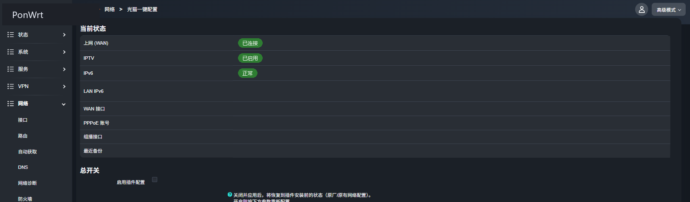

# 光猫一键配置（luci-app-ontoneshot）

[](https://github.com/Wenjw28/luci-app-ontoneshot/actions/workflows/build.yml)
[](https://github.com/Wenjw28/luci-app-ontoneshot/releases)

PonWrt / ImmortalWrt 光猫一键配置插件：一键设置**上网**、**IPTV**、**IPv6**，带总开关可一键还原。

License: GPL-2.0



## 总开关

页面顶部有「启用插件配置」总开关：

| 状态 | 行为 |
| --- | --- |
| **开启** | 按页面参数配置上网 / IPTV / IPv6 |
| **关闭** | **还原到插件安装前的状态** |

首次安装时会把当时的 `network` / `dhcp` / `firewall` / `system` / `sysctl.conf`
保存到 `/root/ontoneshot/baseline/`，关闭开关时用这份基线还原。

> 基线是「插件最早介入前」的快照。如果之后手动改过网络配置，
> 关闭开关会一并回到基线状态。切换前可先 `ontoneshot backup` 留一份当前配置。

## 功能

- **一键配置上网**：PPPoE / DHCP / 静态 IP，自动建立运营商 VLAN 的 802.1q 设备
- **一键配置 IPTV**：独立 VLAN 桥接机顶盒，支持单独组播 VLAN
- **一键开启 IPv6**：LAN 下发 /64、RA + DHCPv6、放行 ICMPv6/DHCPv6、持久化内核参数
- **自动备份 / 一键恢复**：每次执行前备份 network/dhcp/firewall/system/sysctl，可随时回滚
- **状态面板**：WAN 连接状态与 IP、IPTV 状态、IPv6 前缀与 LAN 地址

## 适配环境

- PonWrt SNAPSHOT（ImmortalWrt 25.x/26.x 快照），LuCI 26.x JS 框架，apk 包管理
- 已在 airoha/an7581 平台的 PonWrt 设备实测通过
- UCI + rpcd + LuCI，纯配置改动，不安装任何额外组件

## 安装

### 方式一：下载 Release 安装包（推荐）

到 [Releases](https://github.com/Wenjw28/luci-app-ontoneshot/releases) 下载最新的
`luci-app-ontoneshot-*.apk`（apk 系统）或 `luci-app-ontoneshot_*.ipk`（opkg 系统），上传到路由器后：

```sh
# PonWrt / ImmortalWrt 快照（apk）
apk add --allow-untrusted ./luci-app-ontoneshot-*.apk

# OpenWrt 23.05 及更早（opkg）
opkg install ./luci-app-ontoneshot_*.ipk
```

> 本插件与固件同源构建，安装后自动保存配置基线并重启 rpcd / uhttpd。

### 方式二：源码安装

把整个目录上传到路由器，然后：

```sh
cd /root/luci-app-ontoneshot
sh install.sh
```

安装后打开 LuCI：**网络 → 光猫一键配置**。

卸载：

```sh
sh uninstall.sh
```

## 页面说明

> 插件不预填任何 VLAN/账号/密码。**保存过的值会自动回显**，未填过的显示为空。
> 留空后点按钮 = 保持设备上现有配置不变，不会清空。

### 当前状态
| 项 | 含义 |
| --- | --- |
| 上网 (WAN) | PPPoE/DHCP 是否已连接，显示公网 IPv4 |
| IPTV | IPTV 接口是否已启用 |
| IPv6 | WAN 是否拿到 IPv6 前缀，显示前缀地址 |
| LAN IPv6 | 内网下发的 IPv6 地址 |
| 最近备份 | 当前可回滚到的备份目录 |

### 配置参数

**上网**
| 参数 | 说明 |
| --- | --- |
| 上网方式 | PPPoE 拨号 / DHCP / 静态 IP |
| 上网 VLAN ID | 运营商上网业务 VLAN。**留空则沿用设备当前配置**，不确定不要改 |
| PPPoE 账号/密码 | PPPoE 方式必填 |
| 静态 IP / 网关 | 仅静态 IP 方式需要 |

**IPTV**
| 参数 | 说明 |
| --- | --- |
| 启用 IPTV | 关闭时会移除 IPTV 配置并把端口归还 br-lan |
| IPTV VLAN ID | 运营商 IPTV 业务 VLAN（点播/信令）。**按你的运营商实际情况填** |
| 组播 VLAN ID | 运营商把直播组播放在独立 VLAN 时填（常见做法是点播/组播各一个 VLAN）。留空=与 IPTV VLAN 相同 |
| IPTV 出口网口 | 机顶盒插哪个 LAN 口（lan1-lan4 可选） |
| IPTV 802.1p 优先级 | 运营商按优先级区分业务时填，一般 5。留空保持当前 |

**IPv6**
| 参数 | 说明 |
| --- | --- |
| 一键开启 IPv6 | 开启后 LAN 下发 /64，启用 RA + DHCPv6 |
| 向下游设备通告默认路由 | **接二级路由时必须开**。关掉后 odhcpd 会把 RA 的 Router Lifetime 置 0，二级路由不认本机当 IPv6 网关 |
| 向下游路由器委派前缀（PD） | 二级路由还要给自己的设备分 IPv6 时开 |
| LAN 前缀长度 | PD 开启时的本机前缀长度，一般 62（运营商给 /60 时） |

### 一键操作
| 按钮 | 作用 |
| --- | --- |
| ① 一键配置全部 | 依次执行上网 → IPTV → IPv6，执行前自动备份 |
| ② 只配置上网 | 只重配 WAN |
| ③ 只配置 IPTV | 只重配 IPTV |
| ④ 只开启 IPv6 | 只重开 IPv6 |
| 恢复上次备份 | 回滚到最近一次备份 |

## 命令行用法

脚本也可直接用：

```sh
ontoneshot wan            # 配置上网（执行前自动备份）
ontoneshot iptv           # 配置 IPTV
ontoneshot ipv6           # 开启 IPv6
ontoneshot all            # 全部执行
ontoneshot backup         # 仅备份
ontoneshot restore        # 恢复最近备份
ontoneshot wan --no-backup # 不备份直接执行
```

## 备份位置

```
/root/ontoneshot/backup-YYYYMMDD-HHMMSS/
  network  dhcp  firewall  system  ontoneshot  sysctl.conf
/root/ontoneshot/latest -> 最近一次
```

## 目录结构

```
files/etc/config/ontoneshot                              # 插件自身配置
files/usr/bin/ontoneshot                                  # 主脚本（UCI 操作）
files/usr/share/rpcd/ucode/ontoneshot                     # rpcd 后端（ubus 对象 ontoneshot）
files/usr/share/luci/menu.d/luci-app-ontoneshot.json      # 菜单注册
files/usr/share/rpcd/acl.d/luci-app-ontoneshot.json       # 权限
files/www/luci-static/resources/view/ontoneshot/overview.js  # 页面
files/etc/init.d/ontoneshot-bridge                         # 开机重打桥接参数
files/etc/apk/config                                       # apk 允许未签名
scripts/ponwrt-feedfix.sh                                  # 软件源修复
install.sh / uninstall.sh                                  # 安装 / 卸载
```

## IPTV 桥接的三个隐藏坑（重要）

点播 VLAN 和组播 VLAN 必须放在**同一个桥**里，否则机顶盒收不到组播。
但两条 VLAN 直接桥接会踩三个坑，表现出来都是"**IPTV 获取不到地址**"：

### 坑 1：FDB 冲突（最隐蔽）

运营商网关的 MAC 在两条 VLAN 上都出现，Linux 桥会把它**学到组播口**上。
于是机顶盒发给网关的 DHCP / DNS / 认证单播，全被转发到组播 VLAN，
永远到不了点播 VLAN，运营商自然收不到 —— 机顶盒就一直卡在"获取地址"。

**修复**：组播口关闭 MAC 学习
```sh
bridge link set dev pon0.<组播VLAN> learning off
```

验证：`bridge fdb show br br-iptv | grep <网关MAC>` 应指向 **点播口**。

### 坑 2：组播回灌运营商

组播从组播 VLAN 进来后，桥会泛洪到所有端口，包括点播 VLAN，
等于把组播原路打回运营商，点播口 TX 会异常暴涨（实测可达每秒数 MB）。

**修复**：点播口关闭组播泛洪
```sh
bridge link set dev pon0.<点播VLAN> mcast_flood off
```

### 坑 3：单播误泛洪到组播 VLAN

机顶盒的未知单播会泛洪到组播 VLAN，干扰运营商业务。

**修复**：组播口关闭单播泛洪
```sh
bridge link set dev pon0.<组播VLAN> flood off
```

### 最终端口参数

| 端口 | learning | flood | mcast_flood |
| --- | --- | --- | --- |
| 机顶盒网口 | on | on | on |
| 点播 VLAN | on | on | **off** |
| 组播 VLAN | **off** | **off** | on |

这三项是 **bridge 运行时参数，不写入 UCI**，network 重启或设备重启后全部丢失。
插件在 `apply_iptv` 里会设置并自检，另外 `ontoneshot-bridge` 开机服务会自动重打。

## 二级路由（下游路由器）场景

本机下面再接一台路由器时，IPv6 需要两个开关同时打开：

1. **向下游设备通告默认路由**（ra_default）——必须开。
   不开的表现：光猫自己 IPv6 完全正常，但二级路由下面的设备没有 IPv6。
   根因是 odhcpd 日志里的 `No default route present, setting ra_lifetime to 0!`，
   RA 里 Router Lifetime = 0，下游不认它当网关。

2. **向下游路由器委派前缀（PD）**——二级路由的内网也要 IPv6 时开。
   开启后 LAN 前缀从 /64 改为 /62，下游通过 DHCPv6-PD 拿到 /63 子前缀。
   注意：二级路由自己的 LAN `ip6assign` 要 ≤ 拿到的长度（例如 64），
   否则它虽然拿到了前缀也分不出去。

验证方法（在光猫上）：

```sh
ubus call dhcp ipv6leases | grep -A4 ipv6-prefix   # 能看到下发的子前缀
timeout 6 tcpdump -i br-lan -n -vv 'icmp6 and ip6[40]==134' -c 1 | grep 'router lifetime'
```

## 关闭软件包签名验证

```sh
printf 'allow-untrusted\n' >> /etc/apk/config
```

**注意配置文件是 `/etc/apk/config`，不是 `/etc/apk/apk.conf`**（很多人写错导致不生效）。
apk-tools 3.x 只读 `/etc/apk/config`（或 `$APK_CONFIG` 环境变量），格式为每行一个选项，空格分隔参数，不是 key=value。

已加入 `/etc/sysupgrade.conf`，升级后不会被覆盖。

## 软件源

出厂源里有 3 条无效 feed（`pon_drivers` / `pon_userspace` / `video`），会让 `apk update` 报错。
修复：`sh scripts/ponwrt-feedfix.sh`（可 `restore` 还原）。
详见 [docs/FEED-问题分析.md](docs/FEED-问题分析.md)。

## 许可证

本项目采用 [GNU General Public License v2.0](LICENSE) 许可。

## 注意

- 改 VLAN / 出口网口会导致**短时间内断网**，改完页面会自动刷新状态。
- 桥接模式会把出口网口从 br-lan 摘出，单独组成 br-iptv 与 IPTV VLAN 桥接，
  这期间该网口上的设备会失去内网连通（正常现象）。
- 本插件只改 UCI 配置，不修改固件文件，恢复备份即可完全回滚。